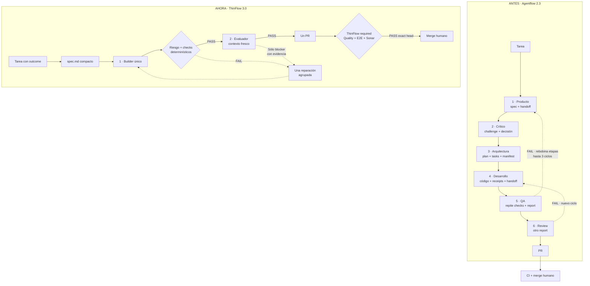

# Flujo de desarrollo

ThinFlow 3.0 es el default para tareas nuevas. El contrato operativo completo
está en [THINFLOW.md](THINFLOW.md).

Puntos de control:

- El diff real determina el riesgo; rutas desconocidas fallan cerradas.
- El builder itera con pruebas enfocadas. La regresión completa corre una vez
  en CI y no se duplica entre agentes.
- Existe un solo dictamen independiente, `evaluation.md`.
- Un segundo bloqueo requiere decisión humana o dividir la tarea.
- Los runs 2.3 guardados continúan con su snapshot original.
