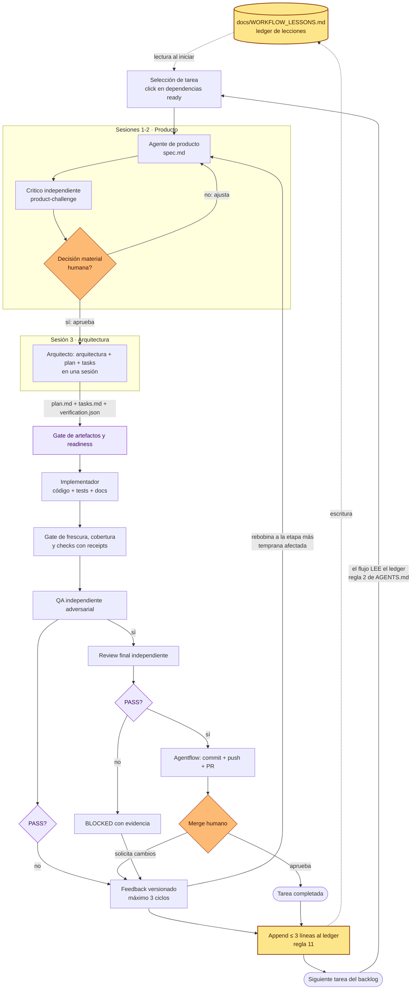

# Flujo de desarrollo (vista completa)

Vista consolidada del flujo Agentflow v2.3 + ledger de lecciones. El detalle
normativo vive en [METODOLOGIA_AGENTICA.md](METODOLOGIA_AGENTICA.md) y las
optimizaciones de etapas en [WORKFLOW_OPTIMIZATIONS.md](WORKFLOW_OPTIMIZATIONS.md).

## Puntos clave

- **Seis sesiones independientes**: producto, crítico, arquitectura (arquitectura +
  plan + tasks en una sesión), implementación, QA y review final.
- **Dos PASS independientes** (QA y review) son condición para el PR; el merge
  siempre es humano.
- **Feedback versionado** rebobina a la etapa más temprana afectada; los
  artefactos ya aprobados se conservan intactos.
- **Ledger de lecciones**: la única memoria cross-task del flujo. Se lee al
  iniciar toda tarea y se escribe (máximo tres líneas) al completar o grabar
  feedback. Los archivos `backlog/feedback/` por tarea quedan intactos y son
  la fuente canónica.
