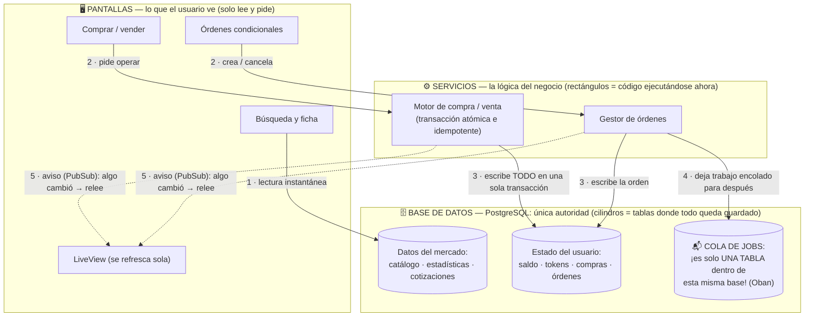
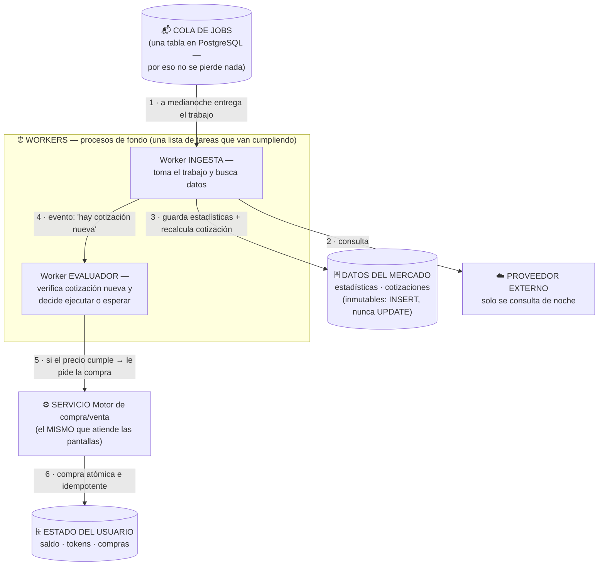

# Arquitectura completa CP2 — versión acordada (octubre 2026)

Frecuencia diaria de recálculo. El diagrama está dividido en dos flujos:
**de día** (lo que dispara el usuario) y **de noche** (lo que hace el sistema solo).

## Cómo leer las formas

| Forma | Significa | Qué es |
|---|---|---|
| 🗄 **Cilindro** | Base de datos / tabla | PostgreSQL: donde TODO queda guardado, incluida la cola |
| ⚙️ **Rectángulo** | Servicio | Lógica del negocio ejecutándose ahora (atiende al usuario) |
| ⏰ **Rectángulo** (zonas "Workers") | Worker | Proceso de fondo: trabaja sin que nadie espere (cola Oban) |
| ☁️ Caja gris | Externo | Proveedor de datos deportivos (solo de noche) |
| Línea **llena** | Llamada / espera → | "a destino" |
| Línea **punteada** | Aviso opcional (PubSub) | nunca es la fuente de verdad, solo despierta a la pantalla |

La clave conceptual: **la cola NO es un servidor aparte — es una tabla dentro de PostgreSQL**.
Eso es lo que hace a Oban "durable": si el servidor muere, el trabajo queda en la base.

## Diagrama 1 — DE DÍA (lo que dispara el usuario)

## Diagrama 2 — DE NOCHE (lo que el sistema hace sin nadie esperando)

Imágenes renderizadas: `cp2_dia.png` y `cp2_noche.png` (en esta misma carpeta).

## El ritmo del sistema en un día

| Hora | Qué pasa |
|---|---|
| Todo el día | Usuario busca (lectura local instantánea), mira ficha con estado de frescura, opera con el precio vigente, crea/cancela órdenes |
| 00:00 | Cron diario: barre jugadores con más de 24 h sin chequear → encola ingesta deduplicada |
| 00:00–0X | Ingesta nocturna: scraper → validar → persistir estadísticas + nueva cotización + evento de evaluación en la misma transacción |
| 00:0X | El evento despierta el worker de Oban, que evalúa las órdenes pendientes de ese jugador: cumplió el precio → compra atómica delegada; no cumplió → queda `pending`; sin saldo/tokens → `rejected` |
| Cada 1 min | Barrido de seguridad repara jobs perdidos, vence órdenes expiradas, retoma pasadas cortadas |
| Post-commit | PubSub avisa el LiveView, que relee de PostgreSQL (el mensaje es solo aviso, nunca autoridad) |

## Decisiones que defendemos

| # | Decisión | Por qué |
|---|---|---|
| 1 | Precio cambia 1 vez al día (recálculo nocturno) | Simple, barato en llamadas, coherente con "reactivo a hechos deportivos". Roadmap: mover el disparo a "fin de partido" sin cambiar nada aguas abajo |
| 2 | Ficha de solo lectura: el usuario nunca dispara ingesta | El precio no debe depender de quién pregunta |
| 3 | Búsqueda 100% local (Redis CP3 como caché, PostgreSQL autoridad) | La falla del proveedor nunca rompe lecturas (invariante 6) |
| 4 | Sin bloqueo de mercado durante el recálculo | La cotización se inserta; el trading siempre lee la vigente y su fecha efectiva |
| 5 | Cotizaciones inmutables, versionadas y reproducibles | Invariante 7: mismos inputs + estrategia → mismo precio. Nadie "mueve" el precio |
| 6 | Todo lo que puede ejecutarse más de una vez va por Oban | Cola durable: at-least-once + idempotencia del dominio = efectivamente una vez |
| 7 | Una sola transacción por operación | Orden + compra + saldo + tokens se confirman juntos, o no existen |
| 8 | PostgreSQL es autoridad; PubSub solo aviso | Reconectar no pierde nada: la pantalla relee la base |

## Frase síntesis para la diapositiva

> "Arquitectura event-driven duradera con frecuencia diaria: PostgreSQL es la única autoridad; el proveedor externo se consulta solo en la ventana nocturna; cada cotización confirmada despierta —en la misma transacción— la evaluación de órdenes; y toda compra, manual o condicionada, se ejecuta con el mismo motor atómico e idempotente. La cadencia es una decisión de producto de hoy: mañana puede ser post-partido sin cambiar la arquitectura."

## Limitación declarada y camino elegido

Si un partido ocurre durante el día, el precio recién refleja ese resultado en la actualización de
las 00:00 — una ventana de hasta ~24 h de desfazaje. El camino elegido (documentado, no
implementado) es atar la ingesta al calendario: de los fixtures ya conocemos el kickoff de cada
jugador; un chequeo programado al terminar el partido dispararía el mismo pipeline (ingesta →
cotización → evaluación de órdenes). El cron nocturno queda como red de seguridad ante fallos,
aplazamientos o proveedor caído.
